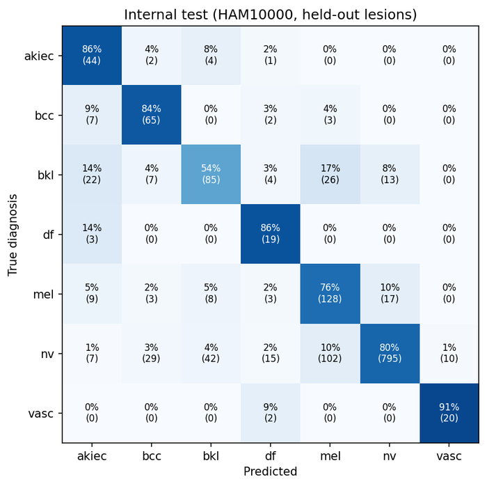
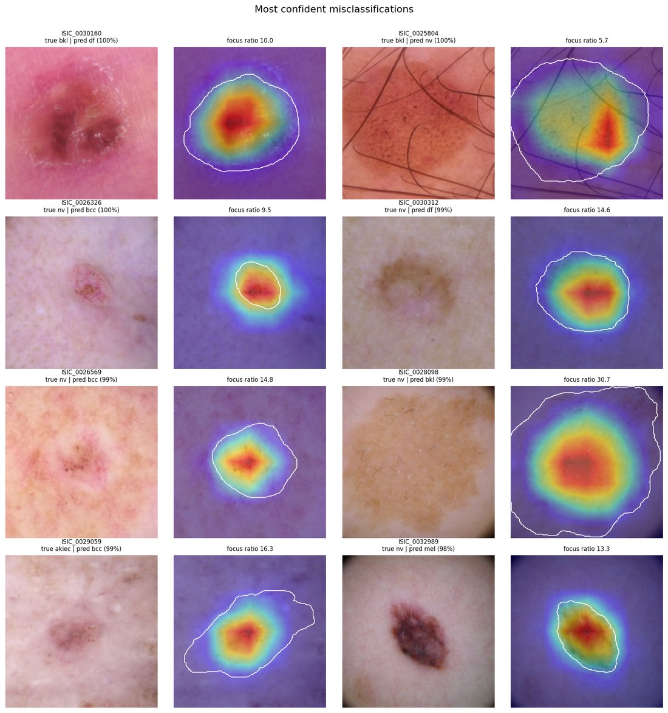
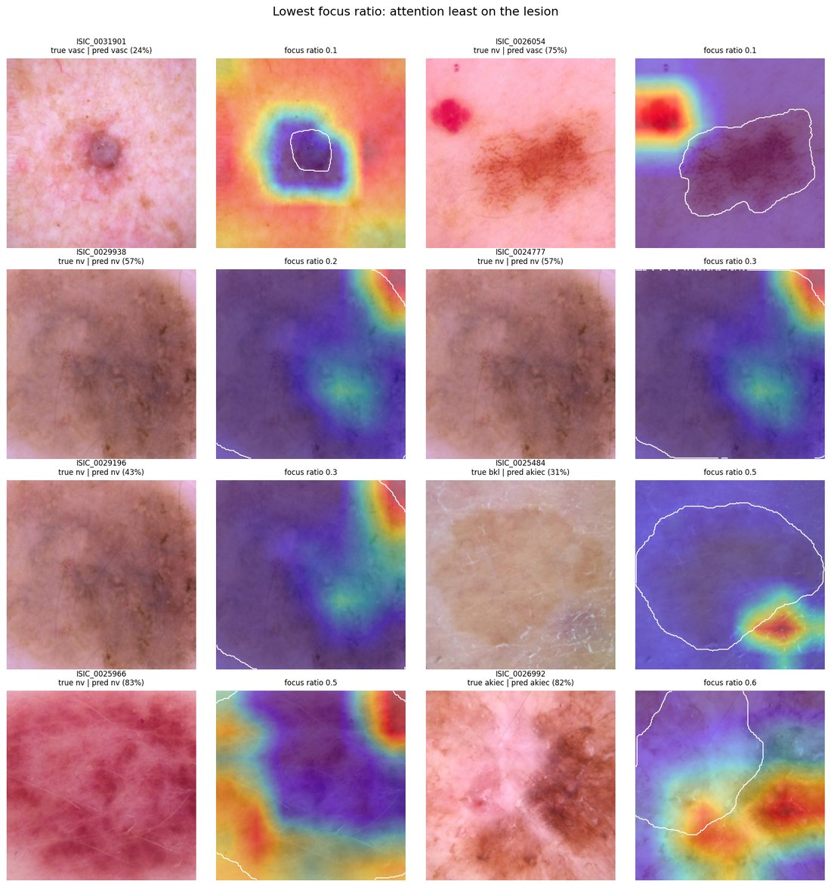

# MelanCare

**Deep learning classification and explainability for dermoscopic skin lesion images**

MelanCare trains a convolutional neural network to classify dermoscopic images of pigmented skin lesions into seven diagnostic categories. It evaluates the model with clinically meaningful metrics, then uses Grad-CAM and expert lesion segmentations to measure whether the model bases its predictions on the lesion itself or on irrelevant parts of the image.

> **Research and education only.** This is not a medical device and must not be used to make decisions about patient care.

**Key results** (EfficientNet-B0, [details below](#results)):
- Balanced accuracy 0.80 on held-out HAM10000 lesions, and 0.75 on the official ISIC 2018 test set.
- At a referral threshold fixed in advance, the model detected 92–94% of malignant or premalignant lesions on both test sets, with about 75% specificity.
- On benign lesions confirmed by histopathology (the suspicious-looking ones that were excised), specificity fell to about 51%. On naevi diagnosed by follow-up it was 99%.
- The Grad-CAM heatmap peaked on the lesion in 98% of images. The most confident errors (98–100% confidence) also looked at the lesion, so attention on the right area does not guarantee correct reasoning.
- Without any correction for class imbalance, plain accuracy was highest (84%), but 39% of melanomas were missed. A class-weighted loss gave the best balanced accuracy, while the ability to rank lesions (AUC) was essentially unchanged.

## Scope

- **Images:** dermoscopic photographs, taken with a dermatoscope, of **pigmented skin lesions**. These are not clinical photographs of general skin disease. The model has never seen eczema, psoriasis, fungal infections, or most other dermatoses, and its outputs on such images would be meaningless.
- **Task:** seven-class diagnosis, plus two derived referral-style decisions: malignant or premalignant vs benign, and melanoma vs rest.
- **Population:** HAM10000 was collected mainly in Austria and Australia, and the images are predominantly of lighter skin. Skin tone is not recorded, so performance on darker skin cannot be assessed with this dataset. That question is the focus of the planned follow-up project (see [Roadmap](#roadmap)).

## Data

[HAM10000](https://doi.org/10.7910/DVN/DBW86T) (Tschandl et al., 2018): 10,015 dermoscopic images of 7,470 lesions. The [ISIC 2018 Task 3](https://challenge.isic-archive.com/data/#2018) test set (1,512 images of 1,223 lesions, including 316 images from sources outside HAM10000) is used as a separate external test set. Both are licensed CC BY-NC 4.0.

| Code | Diagnosis | HAM10000 images | ISIC 2018 test images |
|---|---|---:|---:|
| nv | Melanocytic naevus | 6,705 (67%) | 909 |
| mel | Melanoma | 1,113 (11%) | 171 |
| bkl | Benign keratosis-like lesion (solar lentigo, seborrhoeic keratosis, lichen planus-like keratosis) | 1,099 (11%) | 217 |
| bcc | Basal cell carcinoma | 514 (5%) | 93 |
| akiec | Actinic keratosis / intraepithelial carcinoma (Bowen's disease) | 327 (3%) | 43 |
| vasc | Vascular lesion (angioma, angiokeratoma, pyogenic granuloma, haemorrhage) | 142 (1%) | 35 |
| df | Dermatofibroma | 115 (1%) | 44 |

About half of the HAM10000 diagnoses (53%) are confirmed by histopathology. The rest come from follow-up (37%), expert consensus (9%), or confocal microscopy (<1%).

## Methods

**Lesion-level splitting.** Many lesions in HAM10000 were photographed more than once. If train and test sets are split by image, near-identical photos of the same lesion end up in both, and performance is overestimated. Splitting by lesion prevents this. Here the lesions are divided 70/15/15 into train, validation and test sets, stratified by diagnosis, and the code checks that no lesion appears in more than one split.

**Model.** An ImageNet-pretrained EfficientNet-B0 is fine-tuned on 224×224 images. ResNet-50 and ConvNeXt-Tiny are also available. Augmentations are flips, 90° rotations (dermoscopy has no natural "up"), random crops and mild colour jitter. Colour carries diagnostic information, so the colour changes are kept small.

**Class imbalance.** Naevi make up two-thirds of the data. A model that always predicts "naevus" would be 67% accurate and clinically useless. By default the loss is weighted by inverse class frequency, and the checkpoint with the highest validation **balanced accuracy** (mean per-class sensitivity, the ISIC 2018 challenge metric) is kept. For comparison, `--imbalance sampler` oversamples rare classes and `--imbalance none` applies no correction.

**Evaluation.**
- Per class: sensitivity, specificity, PPV, F1 and one-vs-rest ROC-AUC.
- Overall: accuracy, balanced accuracy, macro F1 and macro AUC.
- **Referral decisions:** malignant or premalignant (mel + bcc + akiec) vs benign, and melanoma vs rest. The decision threshold is fixed on the validation set to reach 90% sensitivity, then applied unchanged to the test sets. Choosing a threshold on the test set would overstate performance.
- **95% confidence intervals** from 1,000 bootstrap resamples. Whole lesions are resampled rather than single images, because images of the same lesion are not independent.
- **Subgroup analysis** by sex, age band, body site, diagnosis method and image source.

**Explainability.** Grad-CAM (Selvaraju et al., 2017) produces a heatmap of the image regions that most increased the score for the predicted class. Each heatmap is compared with the expert lesion segmentation mask. The comparison reports:
- the **focus ratio**: average heat inside the lesion divided by average heat outside it. A value of 1 means the lesion gets no more attention than the surrounding skin. Unlike "share of the heatmap inside the lesion", it is fair to both small and large lesions;
- whether the heatmap peak lies on the lesion.

## Results

EfficientNet-B0 with the class-weighted loss, trained on 7,054 images on a Colab T4 GPU (about 70 seconds per epoch). Training stopped early after epoch 11; the best validation balanced accuracy (0.777) came at epoch 5. Full reports and tables are in [results/effb0_weighted/](results/effb0_weighted/).

### Overall performance

| | Internal test (HAM10000) | External test (ISIC 2018) |
|---|---|---|
| Images (lesions) | 1,497 (1,121) | 1,512 (1,223) |
| Balanced accuracy | 0.797 (95% CI 0.753–0.837) | 0.751 (0.707–0.790) |
| Macro ROC-AUC | 0.964 (0.956–0.971) | 0.956 (0.947–0.964) |
| Macro F1 | 0.671 (0.616–0.713) | 0.666 (0.622–0.705) |
| Accuracy | 0.772 | 0.752 |

The external set is the official ISIC 2018 Task 3 test set, so its balanced accuracy is directly comparable with the challenge leaderboard. The top 2018 entries reached about 0.88, mostly by combining many models and often adding extra training data. This project uses a single small model.

### Per class

| Class | n (internal) | Sensitivity, internal (95% CI) | Sensitivity, external | AUC, internal | AUC, external |
|---|---:|---|---|---|---|
| akiec | 51 | 0.863 (0.755–0.956) | 0.744 | 0.980 | 0.976 |
| bcc | 77 | 0.844 (0.761–0.921) | 0.785 | 0.979 | 0.972 |
| bkl | 157 | 0.541 (0.458–0.619) | 0.654 | 0.933 | 0.926 |
| df | 22 | 0.864 (0.630–1.000) | 0.795 | 0.984 | 0.983 |
| mel | 168 | 0.762 (0.674–0.837) | 0.737 | 0.923 | 0.907 |
| nv | 1,000 | 0.795 (0.765–0.824) | 0.772 | 0.953 | 0.953 |
| vasc | 22 | 0.909 (0.769–1.000) | 0.771 | 0.998 | 0.977 |



### Referral decisions

Thresholds were set on the validation set to reach 90% sensitivity, then applied unchanged to both test sets.

| Task | Test set | Sensitivity (95% CI) | Specificity (95% CI) | PPV | NPV |
|---|---|---|---|---|---|
| Malignant/premalignant vs benign | Internal | 0.936 (0.899–0.965) | 0.753 (0.722–0.783) | 0.483 | 0.979 |
| | External | 0.919 (0.877–0.952) | 0.740 (0.711–0.768) | 0.474 | 0.973 |
| Melanoma vs rest | Internal | 0.911 (0.855–0.958) | 0.708 (0.678–0.739) | 0.283 | 0.984 |
| | External | 0.924 (0.877–0.964) | 0.680 (0.652–0.711) | 0.269 | 0.986 |

The threshold carried over to the external set: sensitivity stayed above the 90% target. At this setting, about half of referred lesions are malignant or premalignant, and a "benign" result is correct about 97–98% of the time.

### Key findings

**1. Performance depends heavily on how difficult the case is.** Specificity for the malignant/benign decision, by how the diagnosis was established:

| Diagnosis method | Internal | External |
|---|---|---|
| Follow-up (naevi monitored over time) | 0.989 | 0.993 |
| Expert consensus | 0.729 | 0.690 |
| Histopathology | 0.508 | 0.524 |

Benign lesions confirmed by histopathology were excised because they looked suspicious, and the model correctly calls only about half of them benign. The headline specificity of 75% is lifted by easy, follow-up naevi. In practice, a decision aid would mostly be consulted on the hard lesions, so the lower figure is the more relevant one.

**2. Benign keratoses are confused with melanoma, and some melanomas are missed.** Benign keratosis-like lesions have the lowest sensitivity (54%): 17% are called melanoma and 14% actinic keratosis, mirroring a known clinical difficulty. 10% of melanomas (17 of 168) were classified as naevi, and only 4 of these 17 crossed the referral threshold. The other 13 would not have been referred.

**3. Performance varies by image source.** For images from one Australian practice (Rosendahl), malignant sensitivity was 0.99 but specificity only 0.38. Image source is entangled with the case mix: the MoleMax images, for example, are almost all naevi under follow-up, with only 5 malignant lesions in the internal test set. A model could learn source-specific image characteristics as a shortcut; this was not tested here. Subgroup tables (sex, age, body site, source) are in [results/effb0_weighted/report.md](results/effb0_weighted/report.md). Many groups are small and have no confidence intervals, so treat them as hints rather than findings.

### Explainability

| Predictions | Images | Median focus ratio | Heatmap peak on lesion |
|---|---:|---:|---:|
| All | 1,495 | 13.9 | 98% |
| Correct | 1,155 | 14.3 | 99% |
| Incorrect | 340 | 12.7 | 95% |

The model concentrates on the lesion in nearly all images, slightly less often when it is wrong. Vascular lesions, which are often small, had the lowest rate (peak on lesion in 91%).

**Attention on the lesion does not guarantee correct reasoning.** The eight most confident errors (98–100% confidence) all had the heatmap squarely on the lesion. The model is also overconfident when wrong. Three of these eight lesions were diagnosed by expert consensus rather than histopathology, so some "errors" may be label errors.



**The least lesion-focused cases reveal limits of the data and of the measure.** One image labelled as a naevus also contains a small red lesion, probably an angioma. The model focused on that lesion and predicted "vascular lesion", while the label describes only the naevus: each image has one label, but some show more than one lesion. Where the lesion fills the whole frame, attention goes to its edge, and the focus ratio handles this poorly.



More examples: [correct predictions for each class](docs/figures/gradcam_correct_by_class.jpg), [training curves](docs/figures/training_curves.png), [malignancy ROC curve](docs/figures/roc_malignant_test.png).

### Class imbalance comparison

The same model was trained three ways, with everything else identical (data split, augmentations, schedule, seed):
- **no correction**;
- **oversampling**, where rare classes are drawn more often during training;
- **weighted loss**, used for all results above.

| Method | Balanced accuracy, internal (95% CI) | Balanced accuracy, external | Accuracy, internal | Melanoma sensitivity, internal / external* | Malignant AUC, internal (95% CI) |
|---|---|---|---|---|---|
| No correction | 0.710 (0.65–0.77) | 0.705 | **0.835** | 0.613 / 0.544 | **0.943** (0.926–0.958) |
| Oversampling | 0.711 (0.65–0.77) | 0.739 | 0.725 | 0.690 / 0.620 | 0.892 (0.868–0.915) |
| Weighted loss | **0.797** (0.75–0.84) | **0.751** | 0.772 | **0.762 / 0.737** | 0.935 (0.917–0.952) |

\* When the model's top prediction is taken as the diagnosis.

- **Plain accuracy is misleading.** The uncorrected model has the highest accuracy (84%) because it labels most lesions as naevi. It misses 39% of melanomas in the internal test set and 46% in the external one.
- **The weighted loss gives the best balanced accuracy and melanoma detection** on both test sets.
- **Imbalance correction mainly moves the decision point; it doesn't improve the model's ability to rank lesions.** The uncorrected and weighted models have almost identical AUCs (malignant 0.943 vs 0.935, melanoma 0.930 vs 0.923, overlapping CIs). With a referral threshold chosen on validation data, the uncorrected model performs comparably: melanoma sensitivity 0.935 at specificity 0.735, vs 0.911 at 0.708 for the weighted loss. For a referral tool with an explicitly set threshold, the correction method matters less than for top-prediction diagnosis.
- **Oversampling performed worst.** It had the lowest AUC (malignant 0.892, with a confidence interval that doesn't overlap the other two models'). Its best validation score came after the first epoch and declined afterwards. This suggests it overfit to the small number of rare-class images it saw over and over (the training set has only 76 dermatofibromas, for example).

These are single training runs per method, so smaller differences may partly reflect run-to-run variation. Full per-class tables: [results/imbalance_comparison.md](results/imbalance_comparison.md).

## Limitations

- **Narrow scope:** only dermoscopic images of seven pigmented lesion types (see [Scope](#scope)).
- **Population:** mostly lighter skin from two countries. Performance on other populations is unknown and may be worse.
- **Clinical context missing:** dermatologists use history, symptoms, evolution over time and palpation, not just a single image.
- **Label quality:** diagnoses not confirmed by histopathology (follow-up or consensus) may contain errors, and each image has one label even when it shows more than one lesion.
- **Overconfidence:** the model can be 98–100% confident and wrong; its probabilities are not calibrated and should not be read as risk estimates.
- **Grad-CAM is coarse and partial:** the heatmap is computed on a 7×7 grid, so it can only roughly locate attention. A heatmap on the lesion does not prove the model uses clinically valid features, and one off the lesion does not prove it is wrong.
- **Single training run per configuration:** confidence intervals reflect sampling uncertainty in the test sets, not variation between training runs.

## How to run

**On Google Colab (recommended, free GPU, nothing to install):**

| Notebook | What it does | Time |
|---|---|---|
| [](https://colab.research.google.com/github/i-oladele/melancare/blob/main/notebooks/colab_train.ipynb) [colab_train.ipynb](notebooks/colab_train.ipynb) | Downloads the data, trains, evaluates and runs Grad-CAM | ~45 min |
| [](https://colab.research.google.com/github/i-oladele/melancare/blob/main/notebooks/colab_imbalance_comparison.ipynb) [colab_imbalance_comparison.ipynb](notebooks/colab_imbalance_comparison.ipynb) | Trains and evaluates the no-correction and oversampling models | ~60 min |

In Colab, choose *Runtime → Change runtime type → T4 GPU*, then *Runtime → Run all*.

**Locally** (Apple Silicon GPU, CUDA or CPU):

```bash
# 1. Environment
python3 -m venv .venv && source .venv/bin/activate
pip install -e ".[dev]"

# 2. Data (about 3.2 GB) into data/raw/. If a download is interrupted, rerun the same
#    command with "-C -" added after "curl" to resume where it stopped.
mkdir -p data/raw
B=https://dataverse.harvard.edu/api/access/datafile
curl -L -o data/raw/HAM10000_metadata.csv "$B/4338392?format=original"
curl -L -o data/raw/ISIC2018_Task3_Test_GroundTruth.csv "$B/6924466?format=original"
curl -L -o data/raw/HAM10000_segmentations.zip "$B/3838943"
S=https://isic-archive.s3.amazonaws.com/challenges/2018
curl -L -o data/raw/ISIC2018_Task3_Training_Input.zip "$S/ISIC2018_Task3_Training_Input.zip"
curl -L -o data/raw/ISIC2018_Task3_Test_Input.zip "$S/ISIC2018_Task3_Test_Input.zip"

# 3. Resize images and create lesion-level splits
python scripts/prepare_data.py

# 4. Train (add --limit 300 --epochs 1 for a quick check)
python scripts/train.py --run-name effb0_weighted

# 5. Evaluate and explain
python scripts/evaluate.py --run runs/effb0_weighted
python scripts/explain.py  --run runs/effb0_weighted

# 6. Compare runs, e.g. imbalance methods
python scripts/compare_runs.py runs/effb0_none runs/effb0_sampler runs/effb0_weighted

# Tests
pytest
```

## Project structure

```
src/melancare/
  data.py        classes, lesion-level split, dataset, augmentations
  model.py       model construction and checkpoint loading
  engine.py      training and prediction loops
  metrics.py     sensitivity/specificity/AUC, bootstrap CIs, referral thresholds
  gradcam.py     Grad-CAM and lesion-focus measures
  plots.py       figures
scripts/         prepare_data, train, evaluate, explain, compare_runs
notebooks/       Google Colab notebooks
results/         evaluation reports and tables from completed runs
docs/figures/    figures used in this README
tests/           unit tests (no data needed)
```

## Roadmap

1. **Skin tone and fairness:** evaluate how skin disease classification varies across Fitzpatrick skin types using Fitzpatrick17k (Groh et al., 2021). This dataset contains clinical photographs rather than dermoscopy, and covers 114 conditions, so it requires a separate model and analysis.

## References

- Tschandl P, Rosendahl C, Kittler H. The HAM10000 dataset, a large collection of multi-source dermatoscopic images of common pigmented skin lesions. *Scientific Data* 5, 180161 (2018).
- Codella N, et al. Skin lesion analysis toward melanoma detection 2018: a challenge hosted by the International Skin Imaging Collaboration (ISIC). arXiv:1902.03368 (2019).
- Selvaraju RR, et al. Grad-CAM: visual explanations from deep networks via gradient-based localization. *ICCV* (2017).
- Tan M, Le Q. EfficientNet: rethinking model scaling for convolutional neural networks. *ICML* (2019).
- Groh M, et al. Evaluating deep neural networks trained on clinical images in dermatology with the Fitzpatrick 17k dataset. *CVPR Workshops* (2021).
